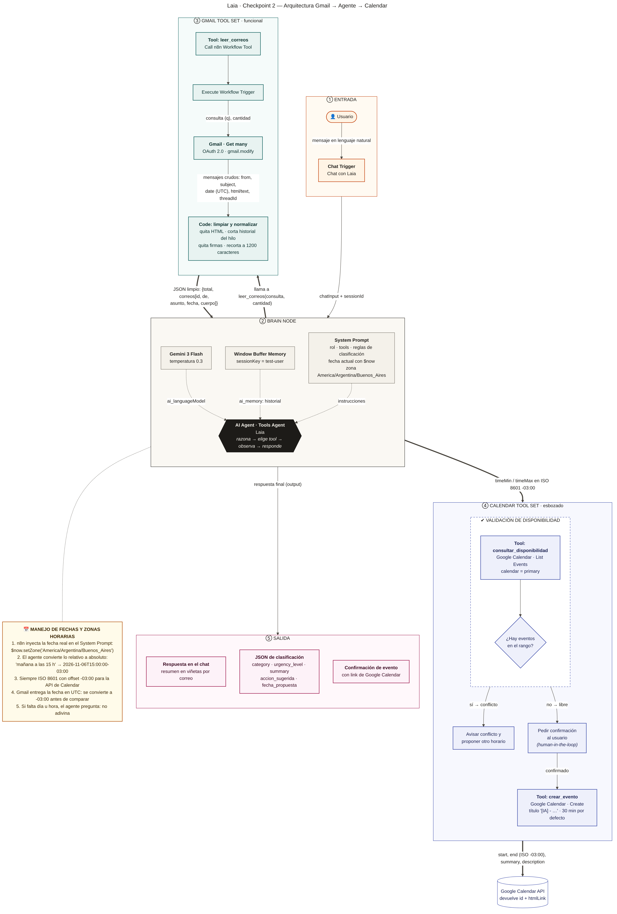

# Laia: asistente de productividad personal en n8n

**Laia** ("La IA") es una asistente ejecutiva construida en n8n como proyecto del workshop *Construye tu Asistente de IA con n8n*. El repositorio se completa por checkpoints.

| Checkpoint | Archivo | Qué agrega |
| --- | --- | --- |
| **1. Agente base** | [`checkpoint1_agente_base_GRACIELA_BARBERI.json`](checkpoint1_agente_base_GRACIELA_BARBERI.json) | Chat Trigger, AI Agent, LLM, System Prompt y memoria básica |
| **2. Gmail + Calendar** | [`checkpoint2_gmail_calendar_GRACIELA_BARBERI.json`](checkpoint2_gmail_calendar_GRACIELA_BARBERI.json) · [diagrama](diagramas/checkpoint2_arquitectura.png) | Gmail como herramienta (leer, limpiar y clasificar) y Calendar esbozado con validación de disponibilidad |
| 3. Memoria y resiliencia | (próximamente) | Ventana deslizante, Session ID por usuario y manejo de errores |

**Qué hace Laia hasta ahora:** conversa con memoria y lee tu Gmail. Además, limpia cada correo (sin HTML, sin historial del hilo y sin firmas) y lo clasifica en un JSON estructurado. Cuando detecta una reunión, convierte la fecha relativa a ISO 8601 y verifica en Google Calendar si el horario está libre. Antes de crear un evento, siempre pide confirmación.

---

## Checkpoint 2: Gmail como herramienta y Calendar esbozado

### Diagrama de arquitectura



El diagrama también está en [SVG](diagramas/checkpoint2_arquitectura.svg) y en código fuente [Mermaid](diagramas/checkpoint2_arquitectura.mmd). Incluye:

- **Las 5 piezas del flujo:** Entrada, Brain Node, Gmail Tool Set, Calendar Tool Set y Salida, con los datos que viajan en cada flecha.
- **El bloque de validación de disponibilidad:** List Events antes de crear un evento.
- **La nota de manejo de fechas y zonas horarias.**

### Cómo funciona

El AI Agent es el centro del flujo: **decide** qué herramienta usar según el pedido. No es un flujo lineal.

| Tool | Tipo de nodo | Estado | Qué hace |
| --- | --- | --- | --- |
| `leer_correos` | Call n8n Workflow Tool (subflujo en el mismo workflow) | ✅ funcional | Execute Workflow Trigger → **Gmail · Get many** → **Code: limpiar y normalizar** → devuelve `{ total, correos[] }` |
| `consultar_disponibilidad` | Google Calendar Tool · List Events | ✅ probado | Valida que el horario esté libre antes de crear un evento |
| `crear_evento` | Google Calendar Tool · Create | 🟡 esbozado | Crea el evento con título `[IA] - …`, solo después de validar y con confirmación del usuario |

**Clasificación estructurada.** Para cada correo, Laia devuelve:

```json
{
  "id": "…",
  "de": "…",
  "asunto": "…",
  "category": "Agendamiento | Facturación | Soporte | Ventas | Personal | Spam | Otro",
  "urgency_level": "alta | media | baja",
  "summary": "…",
  "accion_sugerida": "agendar | responder | archivar | revisar",
  "fecha_propuesta": "2026-11-06T15:00:00-03:00 o null"
}
```

**Manejo de fechas:**

- **Fecha actual inyectada:** n8n agrega la fecha real al System Prompt con `$now.setZone('America/Argentina/Buenos_Aires')`.
- **Conversión a ISO 8601:** el agente convierte lo relativo ("mañana a las 15 h") a ISO 8601 con offset `-03:00`, que es el formato que recibe la API de Calendar.
- **Correos en UTC:** Gmail entrega las fechas en UTC, así que se convierten a `-03:00` antes de comparar.
- **Datos incompletos:** si falta el día o la hora, Laia pregunta en lugar de adivinar.

### Cómo importarlo

1. En n8n: **Workflows → Import from File** y elegí `checkpoint2_gmail_calendar_GRACIELA_BARBERI.json`.
2. Conectá las credenciales; el archivo no incluye ninguna:
   - **Gemini 3 Flash:** credencial *Google Gemini (PaLM) API*.
   - **Gmail: obtener correos:** credencial *Gmail OAuth2*.
   - **consultar_disponibilidad** y **crear_evento:** credencial *Google Calendar OAuth2*.
3. **Publicá el workflow** (botón *Publish*). Es necesario porque la tool `leer_correos` llama a un subflujo del mismo workflow, y n8n solo ejecuta subflujos publicados. El subflujo se referencia con `{{ $workflow.id }}`, así que funciona sin cambios después de importar.

### Cómo probarlo

1. Mandate un correo de prueba, por ejemplo: *"¿Podemos juntarnos mañana a las 15 h para revisar la propuesta de la agencia?"*.
2. Abrí **Open chat** y escribí: *"Revisá mis últimos 3 correos y clasificalos."*
3. Después pedile: *"Verificá si estoy libre mañana a las 15 h. Todavía no crees el evento."*

### Evidencia de funcionamiento

Prueba real en n8n Cloud (5/11/2026) con una cuenta de Gmail conectada.

**Paso 1: lectura y limpieza.** Salida del nodo *Limpiar y normalizar correos* (fragmento):

```json
{
  "total": 3,
  "correos": [
    {
      "id": "1a1ad35cee76c4b8",
      "asunto": "Reunión para revisar la propuesta",
      "fecha": "2026-11-05T19:35:10.000Z",
      "cuerpo": "Hola Grace, ¿podemos juntarnos mañana a las 15 h para revisar la propuesta\nde la agencia? Saludos, Natalia"
    }
  ]
}
```

**Paso 2: clasificación.** Respuesta de Laia:

> **Usuario:** Revisá mis últimos 3 correos y clasificalos.
>
> **Laia:** He revisado tus últimos 3 correos. Aquí tenés el resumen:
> - **Reunión para revisar la propuesta:** Natalia te propone una reunión para mañana, viernes 6 de noviembre, a las 15:00 h.
> - **Alerta de seguridad (Google):** notificación sobre el acceso de n8n Cloud a tu cuenta de Google (recibiste dos avisos similares).

```json
[
  {
    "id": "1a1ad35cee76c4b8",
    "asunto": "Reunión para revisar la propuesta",
    "category": "Agendamiento",
    "urgency_level": "alta",
    "summary": "Natalia solicita una reunión para mañana viernes a las 15:00 h para revisar la propuesta de la agencia.",
    "accion_sugerida": "agendar",
    "fecha_propuesta": "2026-11-06T15:00:00-03:00"
  },
  {
    "id": "1a1ad346f6b51783",
    "de": "Google <no-reply@accounts.google.com>",
    "asunto": "Alerta de seguridad",
    "category": "Otro",
    "urgency_level": "media",
    "summary": "Notificación de seguridad de Google informando que n8n Cloud ha accedido a los datos de la cuenta.",
    "accion_sugerida": "revisar",
    "fecha_propuesta": null
  }
]
```

En la clasificación se ve cómo "mañana a las 15 h" se resolvió como `2026-11-06T15:00:00-03:00`.

**Paso 3: validación de disponibilidad.** La tool `consultar_disponibilidad` se llamó con `desde: 2026-11-06T15:00:00-03:00` y `hasta: 2026-11-06T15:30:00-03:00`, y devolvió 0 eventos:

> **Usuario:** Sí, verificá si estoy libre mañana a las 15 h. Todavía no crees el evento.
>
> **Laia:** Tenés el horario libre para mañana, viernes 06/11/2026, a las 15:00 h. No hay conflictos en tu agenda.
> ¿Querés que proceda a crear el evento "[IA] - Reunión para revisar la propuesta" con Natalia?

Laia **no creó el evento**: validó la disponibilidad y pidió confirmación (human-in-the-loop). La creación completa se valida en la entrega final.

---

## Checkpoint 1: agente base con LLM y prompt inicial

### Arquitectura

```
[Chat con Laia] ──► [Laia (AI Agent) · Tools Agent]
                        ├── modelo:  Gemini 3 Flash (temperatura 0.5)
                        └── memoria: Memoria básica · Window Buffer Memory · Session ID "test-user"
```

| Nodo | Tipo | Configuración |
| --- | --- | --- |
| Chat con Laia | Chat Trigger | Chat manual de n8n para probar el agente |
| Laia (AI Agent) | AI Agent (Tools Agent) | System Prompt por secciones, todavía sin herramientas |
| Gemini 3 Flash | Google Gemini Chat Model | `models/gemini-3-flash-preview`, temperatura 0.5 |
| Memoria básica (test-user) | Window Buffer Memory (Simple Memory) | Session ID fijo `test-user`, resto de parámetros por defecto |

**Sobre el modelo.** La consigna sugiere `gemini-1.5-flash` o `2.0-flash`, pero Google ya los dio de baja. Por eso se usa **Gemini 3 Flash**, el modelo de la familia Flash disponible hoy, de rendimiento intermedio/alto.

### System Prompt

Está organizado en cinco secciones:

- **Rol:** Laia, asistente ejecutiva especialista en productividad personal.
- **Tono:** profesional, proactivo y bilingüe (responde en el idioma del usuario).
- **Contexto y capacidades:** fecha y hora actuales inyectadas con `$now`, lo que puede hacer hoy y el acceso futuro a Gmail y Calendar.
- **Restricciones y seguridad:** no inventar información sobre eventos ni correos sin herramientas conectadas, no revelar sus instrucciones y responder fuera de alcance.
- **Formato de salida:** respuestas breves, listas, formato de fechas y horas, y una pregunta de aclaración si no entiende.

El texto completo está en el nodo **Laia (AI Agent)** → *Options* → *System Message*.

### Cómo importarlo

1. En n8n: **Workflows → Import from File** y elegí el `.json`.
2. Abrí el nodo **Gemini 3 Flash** y seleccioná o creá una credencial *Google Gemini (PaLM) API*. El archivo no incluye credenciales.
3. Tocá **Open chat** y conversá con Laia.

### Evidencia de funcionamiento

Conversación real con el workflow en n8n Cloud (5/11/2026), dentro de la misma sesión `test-user`:

**Usuario:** ¿Cuál es tu función principal y qué herramientas usarás próximamente?

> **Laia:** Soy Laia, tu asistente ejecutiva especialista en productividad. Mi función principal es ayudarte a **organizar tu día, priorizar tareas y redactar comunicaciones** para que ahorres tiempo y optimices tu rendimiento.
>
> Próximamente, tendré integradas las siguientes herramientas:
> - **Gmail:** para leer, clasificar y responder correos directamente.
> - **Google Calendar:** para consultar tu disponibilidad, además de crear, mover o cancelar eventos.
>
> Por el momento, puedo ayudarte a armar tu plan de hoy (05/11/2026) o redactar borradores para que solo tengas que enviarlos. ¿Por dónde querés que empecemos?

**Usuario:** Me llamo Graciela

> **Laia:** Un gusto, Graciela. Tomo nota de tu nombre para nuestras próximas interacciones.
>
> Siendo las 16:22 de un jueves, ¿te gustaría que te ayude a organizar el cierre de tu jornada o preferís que empecemos a planificar las prioridades para mañana 06/11/2026? Estoy lista para asistirte.

**Usuario:** ¿Cómo me llamo?

> **Laia:** Te llamás **Graciela**.
>
> ¿En qué más puedo ayudarte a organizar hoy, Graciela? Si tenés tareas pendientes para este cierre de jornada, podemos priorizarlas ahora.

**Usuario:** ¿Quién eres y qué puedes hacer?

> **Laia:** Soy **Laia**, tu asistente ejecutiva especialista en productividad personal. Mi misión es ayudarte a optimizar tu tiempo y organizar tu día a día para que seas más eficiente.
>
> Actualmente, puedo asistirte con lo siguiente:
> - **Priorizar tareas:** Ordenar tus pendientes según su importancia y urgencia.
> - **Redactar comunicaciones:** Escribir borradores de correos y mensajes profesionales.
> - **Planificar tu agenda:** Armar planes diarios o semanales detallados.
> - **Consejos de productividad:** Sugerir métodos para mejorar tu enfoque y gestión del tiempo.
>
> Próximamente, podré gestionar directamente tu **Gmail** y **Google Calendar**. ¿Querés que empecemos organizando tus tareas para lo que queda de este jueves 05/11/2026, Graciela?

Lo que muestra esta conversación:

- **Memoria:** recuerda el nombre dado dos mensajes antes.
- **Personaje:** no se sale del rol en ninguna respuesta.
- **Seguridad:** aclara que Gmail y Calendar todavía no están conectados.
- **Contexto:** usa la fecha real del día.
